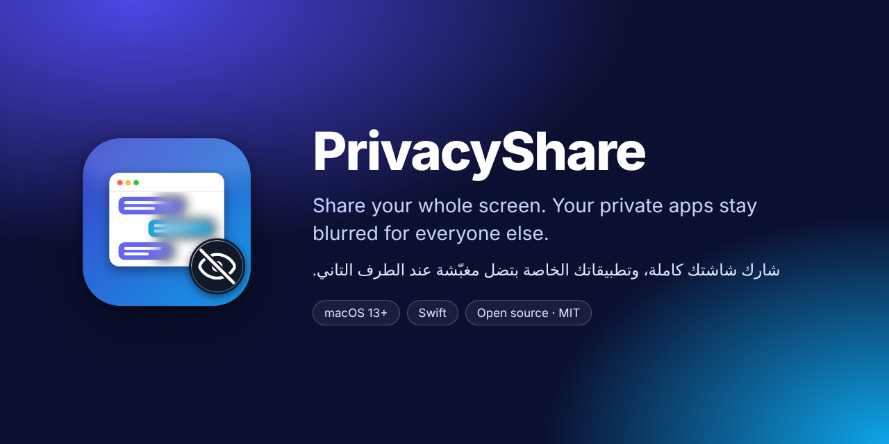
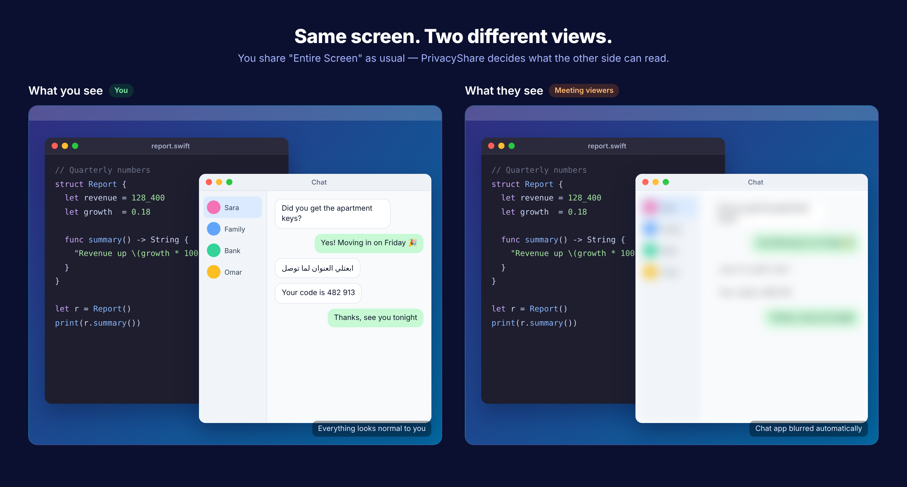
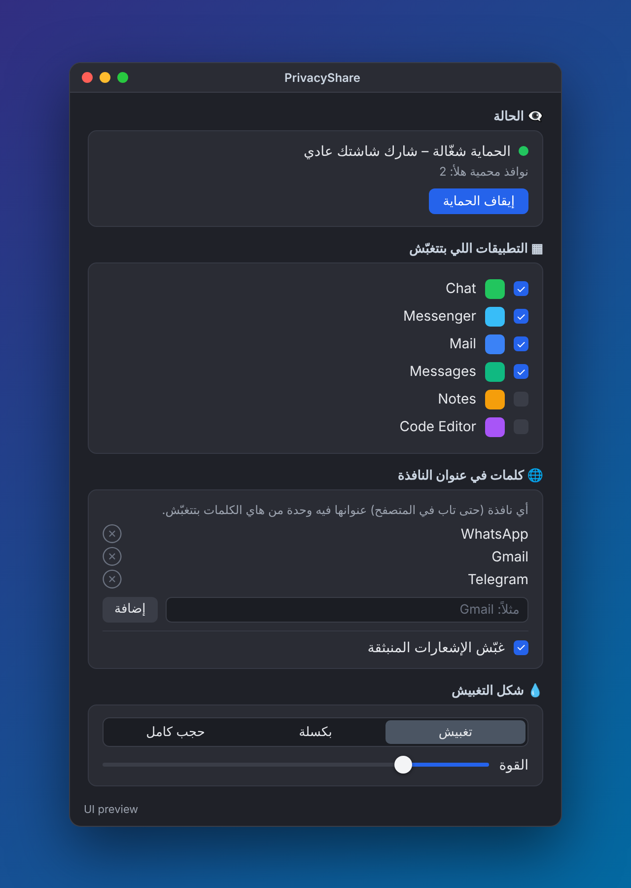

<p align="center">
  
</p>

<p align="center">
  <a href="#العربية">العربية</a> · macOS 13+ · Swift · MIT
</p>

---

## What it does

When you share your **entire screen** in Zoom, Google Meet, Teams or anything else, PrivacyShare blurs the apps you pick, **only for the people watching**. You keep seeing and using them normally.

- Pick apps to hide (WhatsApp, Telegram, Messages, Mail, Signal… preselected).
- Hide browser tabs by keyword in the window title (e.g. `WhatsApp`, `Gmail`).
- Hide notification banners.
- Three styles: blur, pixelate, or solid block, with adjustable strength.
- Lives in the menu bar; no extra windows, no virtual display.

<p align="center">
  
  <br><sub>Illustration of the idea</sub>
</p>

## How it works

For every private window, PrivacyShare places two click-through overlays exactly on top of it:

| Layer | Who sees it | How |
|---|---|---|
| **Blurred copy** | Screen sharing / recordings | Normal window above the private app |
| **Clear live copy** | Only you | Window with `sharingType = .none`, excluded from capture |

Both copies come from a per-window ScreenCaptureKit stream, blurred on the GPU with Core Image. Overlays follow the window ~30 times a second, and clicks pass straight through to the real app.

## Settings

<p align="center">
  
  <br><sub>UI preview: pick apps, add title keywords, choose blur style</sub>
</p>

## Build & run

Requirements: macOS 13 (Ventura) or newer, and Xcode or the Command Line Tools (`xcode-select --install`).

```bash
git clone https://github.com/nooryasserx/PrivacyShare.git
cd PrivacyShare
bash build_app.sh
open build/PrivacyShare.app
```

On first launch, grant **Screen Recording** in System Settings → Privacy & Security, then reopen the app.

> The app is ad-hoc signed, so macOS treats every rebuild as a new app. `build_app.sh` resets the old permission for you; just grant it again after each build.

**Quick test:** turn protection on, open WhatsApp, and take a screenshot (`Cmd + Shift + 3`). WhatsApp should look blurred in the screenshot while it looks normal on your screen.

## Project layout

```
Sources/PrivacyShare/
  PrivacyShareApp.swift   App entry, settings window, menu bar item
  ContentView.swift       Settings UI (Arabic, RTL)
  PrivacySettings.swift   Rules, persisted in UserDefaults
  OverlayManager.swift    30 Hz loop that tracks private windows
  WindowScanner.swift     Decides which on-screen windows are private
  WindowMirror.swift      Per-window capture + the two overlays
  Obscurer.swift          Blur / pixelate / solid filters
Resources/                Info.plist and app icon
docs/                     README images
build_app.sh              Builds and ad-hoc signs PrivacyShare.app
```

## Known limitations

- Some meeting apps or macOS versions may not honor `sharingType = .none`. Always test with a screenshot or a test call before an important meeting.
- If you drag a private window very fast, its edge can show for a split second.
- Browser detection uses the window title (the active tab), not the page URL.

## Roadmap

- [ ] Browser extension for exact per-site detection
- [ ] Multi-monitor polish
- [ ] Signed and notarized release builds
- [ ] Windows version

## Contributing

Issues and pull requests are welcome. For larger changes, please open an issue first to discuss the idea.

## License

[MIT](LICENSE) © 2026 Noor Yasser

---

<div dir="rtl" id="العربية">

## بالعربي

**PrivacyShare** تطبيق ماك مفتوح المصدر. بتشارك شاشتك كاملة بأي برنامج اجتماعات، وانت بتشوف كل شي طبيعي، والطرف التاني بيشوف التطبيقات الخاصة مغبّشة، زي واتساب وتيليغرام والإيميل.

**التشغيل:**

```bash
bash build_app.sh
open build/PrivacyShare.app
```

أول مرة فعّل صلاحية **Screen Recording** من System Settings ← Privacy & Security، وبعدين سكّر التطبيق وافتحه.

**للتجربة:** شغّل الحماية وافتح واتساب وخذ سكرين شوت (`Cmd + Shift + 3`). لازم يطلع واتساب بالصورة مغبّش.

</div>
